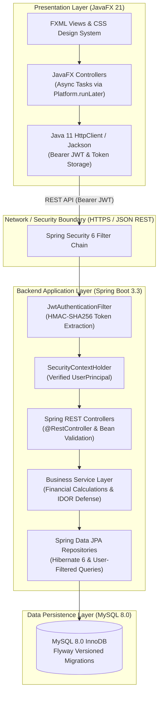
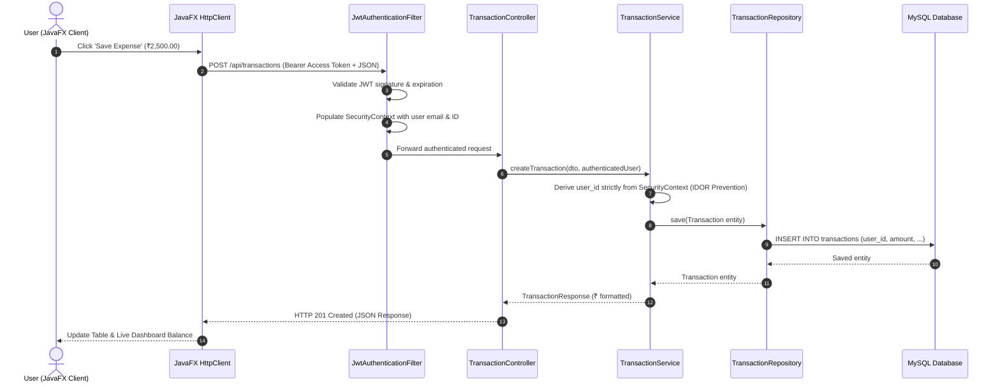
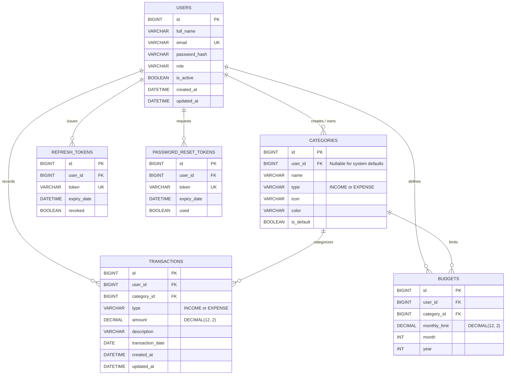

# Smart Spend – Personal Finance Management System

[](https://openjdk.org/)
[](https://spring.io/projects/spring-boot)
[](https://spring.io/projects/spring-security)
[](https://openjfx.io/)
[](https://www.mysql.com/)
[](https://flywaydb.org/)
[](https://maven.apache.org/)
[](LICENSE)

An enterprise-grade, multi-user personal finance management system engineered with a decoupled 3-tier architecture: **JavaFX 21 Desktop Client &rarr; Spring Boot 3 REST API &rarr; MySQL 8.0 Database**.

Designed specifically for the Indian financial context with native **Indian Rupee (`₹` / INR)** currency formatting (Lakhs & Crores numbering system `₹ xx,xx,xxx.xx`), high-precision `BigDecimal` accounting arithmetic, robust multi-tenant data isolation, and bank-grade authentication.

---

## Architecture Overview

Smart Spend strictly enforces decoupled client-server boundaries: **the JavaFX desktop application never connects directly to the MySQL database**. All authentication, authorization, business rules, and financial calculations are executed on the Spring Boot backend.



### Authentication & API Request Flow



---

## Key Features

### 1. Multi-User Authentication & Security
- **Dual-Token JWT Architecture:** Stateless authentication with short-lived Access Tokens (1 hour) and secure Refresh Tokens (7 days) with database-backed token rotation and instant revocation.
- **BCrypt Password Hashing:** All credentials securely hashed using BCrypt with a cost factor of 12 rounds.
- **Strict Multi-Tenant Isolation (Anti-IDOR):** The backend never trusts a `userId` supplied by the frontend client. The authenticated user identity is derived exclusively from the verified JWT `SecurityContextHolder`. Every database query enforces `WHERE user_id = :userId` to prevent Insecure Direct Object References (IDOR).
- **Password Reset System:** Single-use, cryptographically generated token-based password reset workflow.

### 2. Native Indian Financial Experience (`₹` / INR)
- **Indian Numbering System Formatting:** Formatted using `Locale("en", "IN")` complying with Reserve Bank of India standards (e.g., `₹ 1,50,000.00` and `₹ 12,45,670.50`).
- **Zero-Loss Monetary Precision:** Pure `BigDecimal` monetary storage in Java and `DECIMAL(12, 2)` in MySQL to completely eliminate floating-point rounding errors.
- **Pre-seeded Indian Categories:** 18 default categories including Salary, Freelance, Groceries & Kirana, Rent & Housing, Fuel & Travel, Electricity & Water Bills, Dining, Healthcare, and Investments (Mutual Funds / SIP).

### 3. Real-Time Financial Dashboard
- **Metric Cards:** Real-time computation of **Total Income**, **Total Expenses**, **Current Balance**, and **Monthly Savings**.
- **Interactive Visualizations:**
  - Expense Category Breakdown (Interactive Pie Chart).
  - Monthly Income vs. Expense Trends (Bar Chart).
- **Recent Activity:** Live-synced table of latest transactions with color-coded badges (Green for Income, Red for Expense).

### 4. Transaction Management (Income & Expense)
- Create, update, search, filter, and delete transactions.
- Filter by transaction type (`INCOME`, `EXPENSE`), category, custom date range, or keyword search.
- Server-side pagination and sorting (`date`, `amount`, `category`).

### 5. Smart Budgeting & Utilization Tracking
- Set monthly spending limits per category.
- Visual budget progress bars with automatic color coding:
  - **Green:** < 75% utilized.
  - **Amber / Orange:** 75% &ndash; 99% utilized.
  - **Red / Alert:** &ge; 100% exceeded.
- Dynamic remaining balance and utilization percentage calculations.

### 6. Analytics & Financial Reporting
- Monthly financial breakdown summaries with total savings rate calculation.
- Category-wise aggregate spending distribution.
- **CSV Data Export:** One-click download of filtered financial records in comma-separated values format for Excel, Google Sheets, or tax filing.

### 7. Live Stock Market Portfolio & Real-Time Valuation (NSE / BSE)
- **Live Market Rates Integration:** Real-time equity quote streaming for Indian stocks (e.g. `RELIANCE.NS`, `TCS.NS`, `INFY.NS`).
- **Comprehensive Investment Tracking:** Record shares, acquisition price, and purchase dates.
- **Dynamic Valuation & P&L Calculation:** Computes Total Invested, Current Portfolio Valuation, Overall Returns in `₹` and `%`, and daily price fluctuations.
- **Portfolio Asset Allocation Visuals:** Interactive JavaFX Pie Chart displaying asset distribution by market value.
- **Anti-IDOR Multi-Tenant Security:** Every user maintains a strictly confidential equity journal.

### 8. Modern Dark Fintech JavaFX Interface
- High-contrast Dark Fintech styling engineered in modern CSS (`theme.css`).
- Asynchronous non-blocking network operations executed via JavaFX `Task` and `Platform.runLater` to guarantee zero UI lag or freezing.
- Dynamic modal dialogs for transaction, budget, and stock investment creation/editing.

---

## Technology Stack

| Domain | Technology / Library | Version | Purpose |
| :--- | :--- | :--- | :--- |
| **Language** | Java (OpenJDK / Temurin) | 17 LTS | Core programming language |
| **Desktop UI** | JavaFX (Controls, FXML, Graphics) | 21.0.10 | Cross-platform desktop interface |
| **Backend Framework** | Spring Boot | 3.3.5 | Enterprise micro-framework & REST API |
| **Security** | Spring Security | 6.3.4 | Authentication, authorization & filter chain |
| **JWT** | JJWT (io.jsonwebtoken) | 0.12.6 | HMAC-SHA256 dual-token generation & parsing |
| **ORM / Persistence** | Spring Data JPA / Hibernate | 6.5.3 | Object-relational mapping & repository layer |
| **Database** | MySQL | 8.0.x | Relational ACID database |
| **Database Migration**| Flyway | 10.10.0 | Versioned, repeatable database migrations |
| **HTTP Client** | Java 11 `java.net.http.HttpClient` | Built-in | Asynchronous HTTP/2 REST client for JavaFX |
| **JSON Serialization**| Jackson Databind | 2.17.2 | High-performance JSON serialization |
| **Testing** | JUnit 5, Mockito, Spring Boot Test | Latest | Unit, integration, and security test suites |
| **Build & Packaging** | Apache Maven | 3.9+ | Multi-module build management |
| **Containerization** | Docker & Docker Compose | Latest | Reproducible backend & database deployment |

---

## Database Architecture

The relational schema is managed through versioned Flyway migrations (`V1__init_schema.sql` and `V2__seed_default_categories.sql`).



---

## Getting Started

### Prerequisites
1. **JDK 17 LTS or higher** (e.g., Eclipse Temurin 17).
2. **Apache Maven 3.9+** (or use the Maven bundled in IntelliJ IDEA).
3. **MySQL 8.0 Server** (running locally on port `3306` or `3307`, e.g., via XAMPP or Docker).

---

### Step 1: Clone and Configure Database

Create the MySQL database:
```sql
CREATE DATABASE IF NOT EXISTS smartspend CHARACTER SET utf8mb4 COLLATE utf8mb4_unicode_ci;
```

Update your database credentials in `smart-spend-backend/src/main/resources/application.properties` (or set environment variables):
```properties
spring.datasource.url=jdbc:mysql://localhost:3307/smartspend?useSSL=false&allowPublicKeyRetrieval=true&serverTimezone=UTC
spring.datasource.username=root
spring.datasource.password=
```
*(Flyway will automatically execute migrations `V1` and `V2` upon backend startup to create all tables and seed 18 Indian categories).*

---

### Step 2: Build the Multi-Module Project

From the project root directory:
```bash
mvn clean install
```

---

### Step 3: Run the Spring Boot Backend

#### Option A: Command Line
```bash
mvn spring-boot:run -pl smart-spend-backend
```
The REST API will start on **`http://localhost:8080`**.

#### Option B: IntelliJ IDEA
1. Open the project root folder in IntelliJ IDEA.
2. Navigate to `smart-spend-backend/src/main/java/com/smartspend/SmartSpendBackendApplication.java`.
3. Right-click &rarr; **Run 'SmartSpendBackendApplication'**.

---

### Step 4: Run the JavaFX Desktop Client

#### Option A: Command Line
In a second terminal window:
```bash
mvn javafx:run -pl smart-spend-frontend
```

#### Option B: IntelliJ IDEA
1. Navigate to `smart-spend-frontend/src/main/java/com/smartspend/client/SmartSpendApp.java`.
2. Right-click &rarr; **Run 'SmartSpendApp'**.

---

### Default Test Credentials

| Full Name | Email Address | Password | Role |
| :--- | :--- | :--- | :--- |
| Kartik Vairagade | `kartik@example.com` | `password123` | USER |
| Demo Finance User | `demo@smartspend.in` | `Demo@12345` | USER |

*(You can also click **Register Account** on the desktop login screen to register any new user account).*

---

## Running with Docker Compose

To run the complete backend and MySQL database using Docker:

```bash
# Build and start services
docker-compose up -d --build

# Inspect logs
docker-compose logs -f backend

# Stop services
docker-compose down
```

The JavaFX desktop frontend can then be started on your workstation and will automatically communicate with the containerized backend on `http://localhost:8080/api`.

---

## Security Verification & Automated Testing

The project includes unit and integration tests covering authentication, financial calculations, and strict multi-tenant data isolation:

```bash
mvn test
```

### Verified Test Suites
1. **`AuthServiceTest`**: Validates registration, duplicate email rejection, BCrypt hash generation, and token rotation.
2. **`DataIsolationSecurityTest` (Anti-IDOR)**: Simulates User A attempting to read, update, or delete records belonging to User B. Confirms that accessing another user's ID throws `ResourceNotFoundException` / HTTP 404, preventing cross-tenant data leakage.
3. **`FinancialCalculationTest`**: Validates `BigDecimal` arithmetic, monthly savings formulas, negative balance handling, and Indian Rupee locale rounding.

---

## Project Structure

```
smart-spend-finance-manager/
├── pom.xml                                # Aggregator POM (Modules: backend & frontend)
├── docker-compose.yml                     # Docker Compose for MySQL 8 & Backend
├── .gitignore
├── .env.example
├── database/
│   ├── schema.sql                         # Standalone SQL DDL
│   ├── sample-data.sql                    # Initial seed data
│   └── backup_smartspend_original.sql     # Historical legacy database backup
├── docs/
│   ├── ARCHITECTURE.md                    # Deep-dive 3-tier architecture document
│   ├── DATABASE_DESIGN.md                 # Complete schema dictionary & ERD
│   ├── API_DOCUMENTATION.md               # REST API endpoints & JSON payloads
│   ├── TECHNICAL_DECISIONS.md             # Architecture Decision Records (ADRs)
│   └── career/
│       ├── RESUME_PROJECT_ENTRY.md        # Tailored resume bullet points & skills
│       ├── INTERVIEW_PREPARATION.md       # 25+ technical interview Q&A
│       └── PROJECT_WALKTHROUGH.md         # Interview presentation script & demo guide
├── smart-spend-backend/                   # Spring Boot 3 REST API Module
│   ├── Dockerfile
│   ├── pom.xml
│   └── src/
│       ├── main/java/com/smartspend/
│       │   ├── config/                    # SecurityConfig, JwtAuthenticationFilter, WebConfig
│       │   ├── controller/                # Auth, Transaction, Category, Budget, Dashboard, Report
│       │   ├── dto/                       # Request and Response transfer objects
│       │   ├── entity/                    # User, Category, Transaction, Budget, RefreshToken
│       │   ├── exception/                 # GlobalExceptionHandler, Custom exceptions
│       │   ├── repository/                # Spring Data JPA interfaces with user isolation
│       │   ├── security/                  # JwtTokenProvider, UserPrincipal
│       │   ├── service/                   # Business logic implementations
│       │   └── SmartSpendBackendApplication.java
│       └── main/resources/
│           ├── application.properties
│           └── db/migration/              # Flyway migrations V1 & V2
└── smart-spend-frontend/                  # JavaFX 21 Desktop Client Module
    ├── pom.xml
    └── src/
        └── main/
            ├── java/com/smartspend/client/
            │   ├── controller/            # JavaFX view controllers
            │   ├── model/                 # Client UI models & DTOs
            │   ├── service/               # Asynchronous REST API HTTP clients
            │   ├── util/                  # CurrencyHelper (₹), SessionManager, AlertHelper
            │   └── SmartSpendApp.java     # JavaFX Application entrypoint
            └── resources/
                ├── css/theme.css          # Dark Fintech theme styling
                ├── fxml/                  # FXML UI view definitions
                └── images/                # Brand logos & icons
```

---

## Author & Career Profile

**Kartik Vairagade**  
- **GitHub:** [@kartikvairagade1122-sketch](https://github.com/kartikvairagade1122-sketch)  
- **Role:** Java Developer / MCA Graduate  
- **Specialization:** Core Java, Spring Boot, Spring Security, REST APIs, Microservices, Hibernate/JPA, MySQL, JavaFX

---

## License

This project is licensed under the MIT License - see the [LICENSE](LICENSE) file for details.
