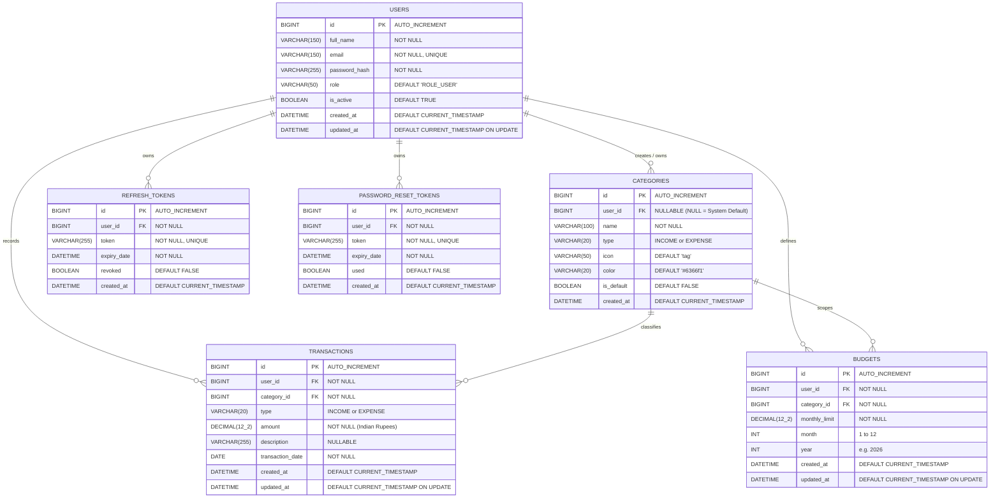

# Database Design & Persistence Specification

## 1. Schema Overview

The Smart Spend database is modeled in **Third Normal Form (3NF)** to ensure transactional integrity, eliminate data redundancy, and enforce strict multi-tenant data boundaries.

The database engine is **MySQL 8.0 InnoDB**, utilizing `utf8mb4` character encoding with `utf8mb4_unicode_ci` collation for full Unicode support.

---

## 2. Entity Relationship Diagram (ERD)

---

## 3. Data Dictionary

### 3.1 Table: `users`
Stores user profile information, authentication credentials, and account status.

| Column | Type | Nullable | Key | Default | Description |
| :--- | :--- | :---: | :---: | :--- | :--- |
| `id` | `BIGINT` | No | PK | Auto Inc | Unique user identifier |
| `full_name` | `VARCHAR(150)` | No | | | User's full legal name |
| `email` | `VARCHAR(150)` | No | UK | | Primary contact & login email (case-insensitive) |
| `password_hash` | `VARCHAR(255)` | No | | | BCrypt hash with 12 rounds |
| `role` | `VARCHAR(50)` | No | | `'ROLE_USER'` | Spring Security authority (`ROLE_USER`, `ROLE_ADMIN`) |
| `is_active` | `TINYINT(1)` | No | | `1` | Account active status flag |
| `created_at` | `DATETIME` | No | | `CURRENT_TIMESTAMP` | Account registration timestamp |
| `updated_at` | `DATETIME` | No | | `CURRENT_TIMESTAMP` | Last profile update timestamp |

### 3.2 Table: `categories`
Stores income and expense classifications. Supports system-wide defaults as well as user-customized categories.

| Column | Type | Nullable | Key | Default | Description |
| :--- | :--- | :---: | :---: | :--- | :--- |
| `id` | `BIGINT` | No | PK | Auto Inc | Unique category ID |
| `user_id` | `BIGINT` | Yes | FK | `NULL` | Owner ID. If `NULL`, category is a system default visible to all users |
| `name` | `VARCHAR(100)` | No | | | Category name (e.g., 'Groceries & Kirana', 'Salary') |
| `type` | `VARCHAR(20)` | No | | | Classification: `'INCOME'` or `'EXPENSE'` |
| `icon` | `VARCHAR(50)` | Yes | | `'tag'` | UI icon token |
| `color` | `VARCHAR(20)` | Yes | | `'#6366f1'` | Hex color code for charts and badges |
| `is_default` | `TINYINT(1)` | No | | `0` | Flag indicating global default category |
| `created_at` | `DATETIME` | No | | `CURRENT_TIMESTAMP` | Creation timestamp |

### 3.3 Table: `transactions`
Core financial journal storing every income and expense entry.

| Column | Type | Nullable | Key | Default | Description |
| :--- | :--- | :---: | :---: | :--- | :--- |
| `id` | `BIGINT` | No | PK | Auto Inc | Unique transaction ID |
| `user_id` | `BIGINT` | No | FK | | Owner ID for strict multi-tenant isolation |
| `category_id`| `BIGINT` | No | FK | | Associated category |
| `type` | `VARCHAR(20)` | No | | | `'INCOME'` or `'EXPENSE'` |
| `amount` | `DECIMAL(12, 2)`| No | | | Value in Indian Rupees (`₹`) up to `9,99,99,99,999.99` |
| `description`| `VARCHAR(255)` | Yes| | `NULL` | User description or notes |
| `transaction_date`| `DATE` | No | | | Date when the transaction occurred |
| `created_at` | `DATETIME` | No | | `CURRENT_TIMESTAMP` | Insertion audit timestamp |
| `updated_at` | `DATETIME` | No | | `CURRENT_TIMESTAMP` | Last modification audit timestamp |

### 3.4 Table: `budgets`
Defines monthly spending thresholds per expense category.

| Column | Type | Nullable | Key | Default | Description |
| :--- | :--- | :---: | :---: | :--- | :--- |
| `id` | `BIGINT` | No | PK | Auto Inc | Unique budget ID |
| `user_id` | `BIGINT` | No | FK | | Owner ID |
| `category_id`| `BIGINT` | No | FK | | Budgeted expense category |
| `monthly_limit`| `DECIMAL(12, 2)`| No | | | Maximum monthly allocation in Indian Rupees (`₹`) |
| `month` | `INT` | No | | | Calendar month (1–12) |
| `year` | `INT` | No | | | Calendar year (e.g., 2026) |
| `created_at` | `DATETIME` | No | | `CURRENT_TIMESTAMP` | Insertion timestamp |
| `updated_at` | `DATETIME` | No | | `CURRENT_TIMESTAMP` | Modification timestamp |

**Constraint:** Composite Unique Key `uk_user_category_month_year (user_id, category_id, month, year)` prevents duplicate budgets for the same category in the same month.

### 3.5 Table: `refresh_tokens`
Stores active refresh tokens for the dual-token JWT authentication flow.

| Column | Type | Nullable | Key | Default | Description |
| :--- | :--- | :---: | :---: | :--- | :--- |
| `id` | `BIGINT` | No | PK | Auto Inc | Unique token record ID |
| `user_id` | `BIGINT` | No | FK | | User who owns the session |
| `token` | `VARCHAR(255)` | No | UK | | Cryptographically random UUID token |
| `expiry_date`| `DATETIME` | No | | | Expiration timestamp (7 days from creation) |
| `revoked` | `TINYINT(1)` | No | | `0` | Revocation status flag |
| `created_at` | `DATETIME` | No | | `CURRENT_TIMESTAMP` | Token creation timestamp |

---

## 4. Performance Indexes

To optimize high-frequency queries and dashboard aggregations, the schema includes the following strategic composite indexes:

1. **`idx_tx_user_date (user_id, transaction_date)`**: Speeds up transaction history queries, date-range filters, and monthly dashboard aggregations.
2. **`idx_tx_user_cat (user_id, category_id)`**: Optimizes category breakdown calculations and budget utilization calculations.
3. **`idx_tx_user_type (user_id, type)`**: Accelerates total income and total expense summaries.
4. **`idx_budget_user_period (user_id, year, month)`**: Speeds up monthly budget retrieval for the dashboard and budget screen.

---

## 5. Flyway Migration Strategy

Database versioning is controlled using **Flyway Community 10.10.0**:

- **`V1__init_schema.sql`**: Creates tables (`users`, `categories`, `transactions`, `budgets`, `refresh_tokens`, `password_reset_tokens`) and declares foreign key cascades and composite indexes.
- **`V2__seed_default_categories.sql`**: Inserts 18 comprehensive default categories localized for Indian users (e.g., *Groceries & Kirana, Fuel & Commute, Mutual Funds / SIP, Rent & Maintenance*).
